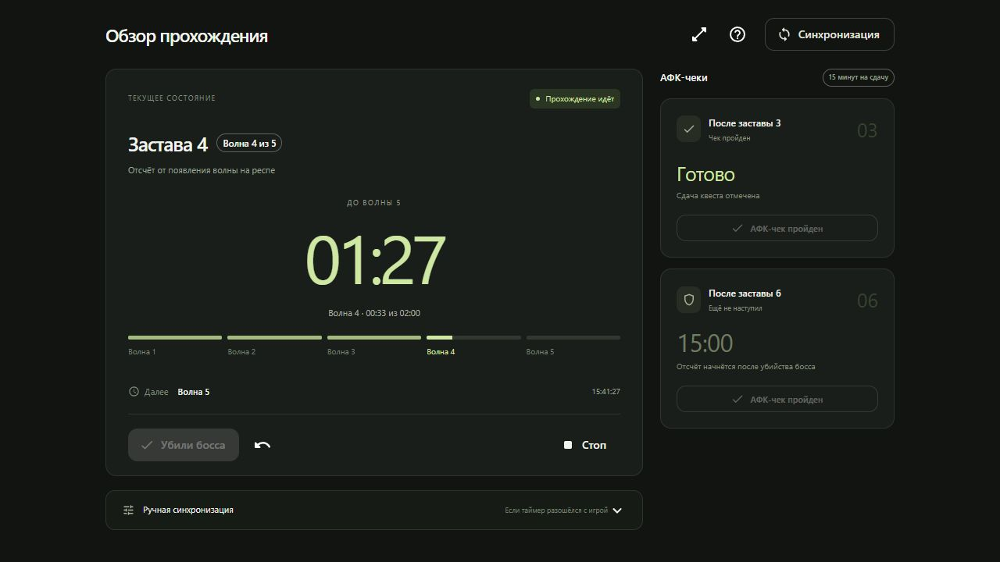

# Гуй Му Observer

Трекер подземелья **Гуй Му — Магистр** для сервера **Comeback PW**: волны, заставы, боссы и АФК-чеки в одной панели.

Работает в браузере и устанавливается как **PWA** — отдельное приложение с иконкой и собственным окном. После первого открытия и подготовки кэша доступен без интернета. Сессия и история хранятся на устройстве; учётная запись и серверная база не нужны.



## Возможности

- Автоматическое расписание 9 застав по 5 волн, интервал 2 минуты.
- Два последовательных босса на заставах 2 и 5, отдельный финальный босс.
- Независимые 15-минутные АФК-чеки после боссов застав 3 и 6.
- Лимит 15 минут на каждого босса, включая второго и финалку; общий лимит данжа — 4 часа. При истечении сессия завершается с сохранением причины и точного времени.
- Таймеры волны, заставы, боя и всего прохождения; расписание ближайших событий.
- Подключение посреди данжа: выбор заставы, фазы, прошедшего времени и состояния чеков.
- Ручная синхронизация, коррекция времени ±10 секунд и отмена до 50 действий.
- Отладочная кнопка «Далее» для прохождения всех этапов без ожидания.
- Автоматическое сохранение и восстановление сессии и журнала событий.
- Статистика и история заходов: результаты, лучшие и средние времена, фильтры и подробный журнал событий.
- Компактный вид, адаптивная панель, локальная работа и установка как приложение.
- Обновление PWA по кнопке, без принудительной перезагрузки во время активного прохождения.

Экспорт/импорт данных, звук и глобальные горячие клавиши пока не реализованы. Текущая версия — **0.2.0**; история изменений — [CHANGELOG.md](CHANGELOG.md).

## Правила Comeback PW

1. ПЛ берёт квест — сразу появляется первая волна на респе. В этот момент нужно запустить таймеры.
2. Каждая следующая волна появляется через 120 секунд, независимо от скорости убийства мобов.
3. После пятой волны до первого босса также отсчитываются 120 секунд. **Этот интервал пока принят как рабочее предположение и требует проверки в игре.**
4. На заставах 2 и 5 после первого босса сразу появляется второй.
5. После последнего босса заставы сразу начинается первая волна следующей заставы.
6. После босса заставы 9 сразу появляется финалка без дополнительных волн.
7. После убийства боссов застав 3 и 6 нужно за 15 минут сдать АФК-квест НИПу в бобовнике. Волны при этом продолжаются.

Бобы, нимбы и время движения мобов по подземелью не учитываются. Обычный гайд: [«Гуй Магистр в подробностях»](https://pwonline.ru/forums/showthread.php?t=72745); изменения Comeback PW имеют приоритет.

## Установка как desktop web-приложение

После публикации адрес сайта будет: **https://mrhat24.github.io/gui-mu-observer/**.

1. Откройте сайт в **Chrome или Microsoft Edge** на Windows.
2. Нажмите **«Установить»** в трекере или воспользуйтесь пунктом установки приложения в меню браузера / значком в адресной строке.
3. Подтвердите установку в браузере. Трекер появится среди приложений и будет открываться отдельным окном.
4. Для офлайн-работы сначала откройте его с интернетом и дождитесь подготовки кэша.

Если браузер не предлагает установку, кнопка показывает инструкцию. Во встроенном браузере Codex может потребоваться открыть сайт во внешнем Chrome или Edge. Сам трекер продолжит работать и без установки.

Закрытое приложение не выполняет код постоянно: после открытия оно пересчитает волны по сохранённым временным меткам. Убийства боссов требуют подтверждения игрока. Для своевременного отображения событий держите приложение открытым.

При запуске установленной desktop PWA приложение запрашивает окно **1360 × 960**, ограниченное рабочей областью экрана. Браузер/ОС могут проигнорировать запрос; принудительно запретить изменение размера окна средствами PWA нельзя. Для установленного приложения и невысоких desktop-окон используется более плотная компоновка. На небольшом экране или при раскрытии дополнительных блоков остаётся прокрутка.

## Локальный запуск и разработка

Требуются **Node.js 24** и **pnpm 11.25.0**. Например, pnpm можно установить через `npm install --global pnpm@11.25.0`.

```sh
git clone https://github.com/mrhat24/gui-mu-observer.git
cd gui-mu-observer/web
pnpm install --frozen-lockfile
pnpm dev
```

Откройте **http://127.0.0.1:5173/**. В dev-режиме service worker отключён, чтобы офлайн-кэш не мешал разработке.

Проверки и сборка:

```sh
cd web
pnpm lint
pnpm format:check
pnpm test
pnpm build
pnpm preview
```

`pnpm build` проверяет TypeScript, собирает приложение и service worker, затем проверяет итоговые пути, manifest, PNG-иконки и включение ресурсов в офлайн-кэш.

`pnpm format` применяет единый стиль Prettier. ESLint проверяет TypeScript, правила хуков React и зависимости эффектов. Регрессионные тесты покрывают очередь команд при сохранении, повторное подключение React, задержку открытой формы, проверку сохранённых данных и порядок событий после возвращения во вкладку.

### Запуск готовой сборки на Windows

После `pnpm build` запустите **`start-web.cmd`** из корня проекта. Он откроет браузер и локальный статический сервер. Окно сервера нужно оставить открытым; Ctrl+C его останавливает. Сервер слушает только `127.0.0.1`.

Node.js нужен для локального сервера. После публикации на GitHub Pages и установки PWA Node.js на компьютере пользователя не нужен.

Без автоматического открытия браузера:

```sh
node web/scripts/serve.mjs
```

Порт можно задать переменной `PORT` (по умолчанию 5173). Сервер определяет путь приложения по manifest готовой сборки.

### Проверка сборки для GitHub Pages

PowerShell:

```powershell
cd web
$env:VITE_BASE_PATH = '/gui-mu-observer/'
pnpm build
pnpm preview
```

Bash:

```sh
cd web
VITE_BASE_PATH=/gui-mu-observer/ pnpm build
pnpm preview
```

Путь на preview: `/gui-mu-observer/`. Для локальной сборки в корне удалите переменную `VITE_BASE_PATH` из окружения и выполните `pnpm build` повторно. Образец настройки — `web/.env.example`.

## Публикация на GitHub Pages

Workflow: [`.github/workflows/pages.yml`](.github/workflows/pages.yml).

1. В репозитории откройте **Settings → Pages → Build and deployment → Source: GitHub Actions**.
   В **Settings → Environments → github-pages → Deployment branches and tags** выберите **Selected branches and tags** и добавьте правило типа **Branch** с именем `master` (либо `main`, если публикуете из неё). Без этого правила GitHub может отклонить deploy, даже если build прошёл. После исправления настройки откройте упавший workflow и выберите **Re-run jobs → Re-run failed jobs**.
2. Добавьте файлы в первый коммит и отправьте текущую ветку:

   ```sh
   git add .
   git commit -m "Add Gui Mu tracker with GitHub Pages and PWA"
   git push -u origin master
   ```

   Если используете ветку `main`, укажите её вместо `master`.

3. Дождитесь успешного workflow **Build and deploy GitHub Pages** во вкладке Actions.
4. Откройте адрес из шага Deploy: **https://mrhat24.github.io/gui-mu-observer/**.

Workflow запускает установку по lockfile, линтер, проверку форматирования, тесты и сборку. Actions закреплены по SHA коммитов. Push в `main` или `master` публикует артефакт `web/dist`; pull request только проверяет сборку, без публикации. Возможен ручной запуск через `workflow_dispatch`. Отдельный deploy token не нужен: используются стандартные разрешения GitHub Pages и OIDC.

Для другого имени репозитория измените `VITE_BASE_PATH` в workflow. Все пути ассетов, scope, идентификатор PWA и start URL формируются из этой базы.

## Управление

| Действие | Поведение |
| --- | --- |
| Старт | Новая сессия или подключение к текущему состоянию |
| Убили босса | Сразу запускает следующего босса / заставу; после финалки завершает данж |
| Далее | Отладочный переход к следующей волне либо имитация убийства текущего босса |
| Синхронизация | Произвольное исправление текущей заставы, фазы и чеков |
| Следующая волна | Ручной переход; после пятой волны — к первому боссу |
| Следующая застава | Ручной переход без фиктивного подтверждения убийства |
| АФК-чек пройден | Отдельная отметка сдачи соответствующего квеста |
| Отмена | Отменяет последнее ручное действие; история сохраняется после перезагрузки |
| Стоп | Фиксирует таймеры и сохраняет незавершённую сессию |

Обычное закрытие вкладки не останавливает сессию. Прогресс заставы показывает фиксированную часть до первого босса; во время боя идёт обратный отсчёт лимита. Начало будущей заставы заранее точно неизвестно — оно зависит от убийства последнего босса.

Во время боя основной таймер показывает остаток от 15 минут, а подпись — сколько длится бой. Каждый следующий босс получает собственные 15 минут. В карточке общего лимита виден остаток от четырёх часов. На самой границе срока лимит считается истёкшим: позднее подтверждение убийства не засчитывается. АФК-чеки имеют отдельные сроки.

При подключении посреди данжа поле «Прошло с начала данжа, сек» позволяет восстановить общий лимит. Пустое поле означает неизвестное начало; приложение не выдаёт время с подключения за начало четырёхчасового отсчёта. Для обычного нового захода начало фиксируется автоматически. Перезагрузка страницы сохраняет начало текущей волны/боя и данжа, а также сроки чеков: время вне приложения учитывается. Если за это время истёк лимит, результат фиксируется на момент истечения.

Если приложение не знало об убийстве босса и показало истечение срока, кнопка «Синхронизация» позволяет указать актуальную фазу из игры. Общее начало данжа при этом сохраняется, пока вы явно не измените его в форме; коррекция записывается в историю.

Кнопка «Далее» находится в раскрывающемся блоке «Ручная синхронизация». Её использование помечает сессию как отладочную и сохраняет события `debug:next`. АФК-чеки при этом продолжают отсчитывать реальное время; их можно подтвердить отдельно. Истечение АФК-чека не завершает данж автоматически.

После убийства финального босса основной таймер показывает общее время прохождения, зафиксированное на момент завершения. Результат виден и в компактном режиме и восстанавливается после перезагрузки. При подключении посреди данжа вместо неизвестного общего времени показывается время с подключения с соответствующей подписью.

## Данные и офлайн-режим

### Статистика в версии 0.2

Откройте «Статистика» в верхней панели или боковом меню. Текущая сессия продолжает работать при переключении экранов. Доступны фильтры за 7/30 дней и всё время, выбор результата и показ отладочных заходов (по умолчанию скрыты). Подробности открываются по дате захода в таблице: АФК-чеки, время боёв и журнал событий.

Лучшее и среднее время учитывают только успешные прохождения с отслеживанием от старта, без отладки и подключения посреди данжа. Процент прохождений считается среди завершённых попыток, включая остановленные и просроченные; активные заходы в знаменатель не входят. Для неизвестного начала показана длительность с подключения. При ручных коррекциях и отменах замеры боёв не рассчитываются, чтобы повторные подтверждения не искажали результат.

Ранее сохранённые прохождения доступны после обновления. Структура IndexedDB обновляется до версии 2 без удаления данных; добавляется индекс событий по сессии. Повреждённые записи истории пропускаются с предупреждением, исходные данные сохраняются.

IndexedDB `gui-mu-observer-v1` хранит:

- `meta` — текущую сессию, ревизию и историю отмены;
- `sessions` — прохождения, включая остановленные;
- `events` — переходы, подтверждения, коррекции и снимки состояния.

Сессия и события сохраняются одной транзакцией. Устаревшая команда из другой вкладки отклоняется, чтобы не потерять изменения.

Внутри вкладки ручные команды выполняются последовательно и ждут текущую запись таймера. При чтении проверяются сессия, ревизия и история отмены. Если данные повреждены, приложение показывает ошибку и не перезаписывает исходную запись. Открытая форма синхронизации не останавливает таймеры: нетронутые поля сохраняют актуальную фазу и исходные сроки чеков; введённое вручную время применяется на момент подтверждения.

Данные привязаны к **браузеру и origin** (протокол, домен и порт). Локальная версия и GitHub Pages имеют разную историю; автоматического переноса пока нет. Сайт и установленная PWA используют одни данные при одном браузерном профиле и адресе. Очистка данных сайта или удаление профиля браузера удалит историю.

Service worker кэширует оболочку приложения и ассеты; IndexedDB хранит прогресс отдельно от этого кэша. Обновление приложения не очищает сессии. Новая версия предлагается через уведомление; кнопка обновления доступна после остановки/завершения прохождения. Системное время должно быть корректным. Браузер может замедлять фоновые вкладки; при возвращении таймеры пересчитываются.

## Стек и структура

**React · TypeScript · Material UI / Emotion · Sass / SCSS Modules · Vite · IndexedDB / idb · Vite PWA / Workbox · Vitest**

```text
.github/workflows/pages.yml    CI и публикация GitHub Pages
web/
  src/
    domain/dungeon.ts         Модель прохождения, независимая от React
    domain/rules.ts           Общие правила и интервалы подземелья
    domain/validation.ts      Проверка данных на границе хранилища
    domain/timerView.ts       Расчёт отображаемого состояния таймера
    services/TrackerService.ts Последовательная обработка команд
    storage/database.ts       Транзакции IndexedDB
    hooks/useTracker.ts       Восстановление и обновление состояния
    components/               Таймер, маршрут, чеки, синхронизация и PWA
    styles/                   Sass и SCSS Modules
    designTokens.ts           Общие цвета и проверяемый контраст текста
    theme.ts                  Общая тема Material UI
    App.tsx                   Панель трекера
  public/                     Иконки приложения
  scripts/                    Проверка сборки и локальный сервер
  tests/                      Механика, восстановление и хранение
start-web.cmd                 Запуск готовой сборки на Windows
```

Справка по платформе: [GitHub Pages с Vite](https://vite.dev/guide/static-deploy.html#github-pages), [Vite PWA](https://vite-pwa-org.netlify.app/guide/), [установка PWA](https://developer.mozilla.org/en-US/docs/Web/Progressive_web_apps/Guides/Making_PWAs_installable).

## Состояние зависимостей

После обновления инструментов разработки проверка `pnpm audit` от 28.10.2026 не показывает критических, высоких и средних уязвимостей. Остаётся одна низкая в `deepmerge`, транзитивной зависимости сборщика Workbox: [GHSA-gcqx-w48m-w2h4](https://github.com/advisories/GHSA-gcqx-w48m-w2h4). Исправленная версия ещё не опубликована; зависимость используется при сборке, а не для обработки пользовательских данных в браузере. При следующем обновлении Workbox/PWA нужно повторить аудит. В зависимостях production известных уязвимостей на момент проверки нет.
